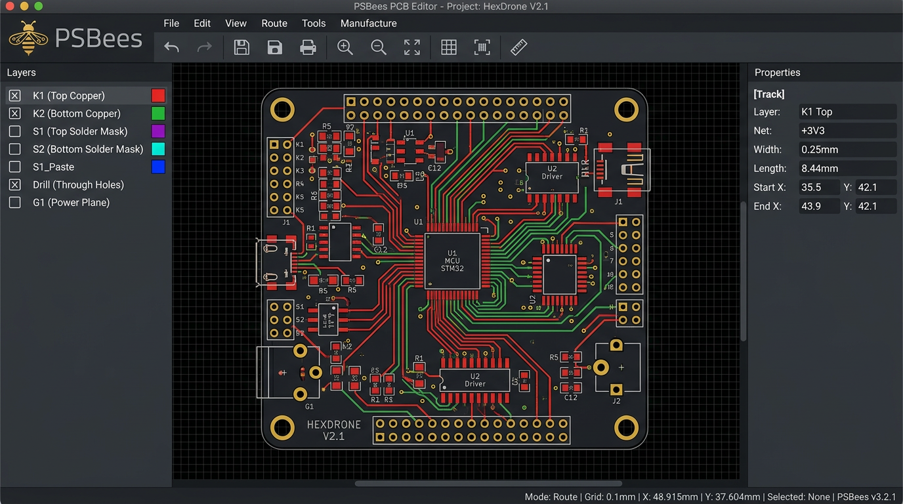
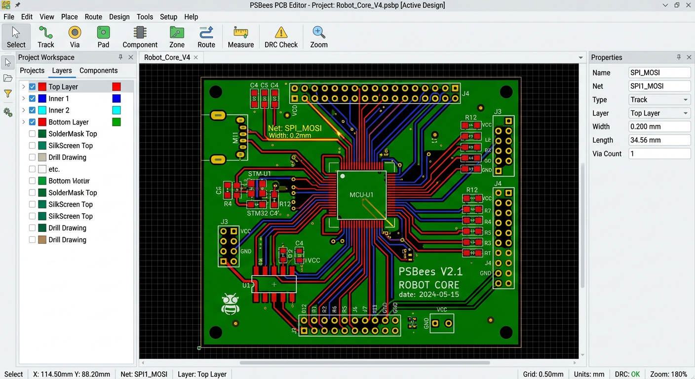
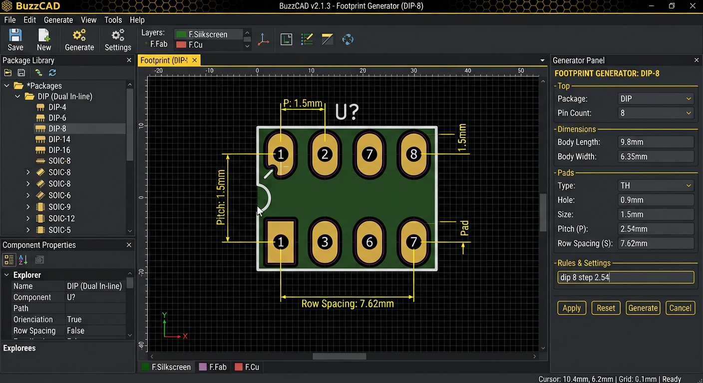
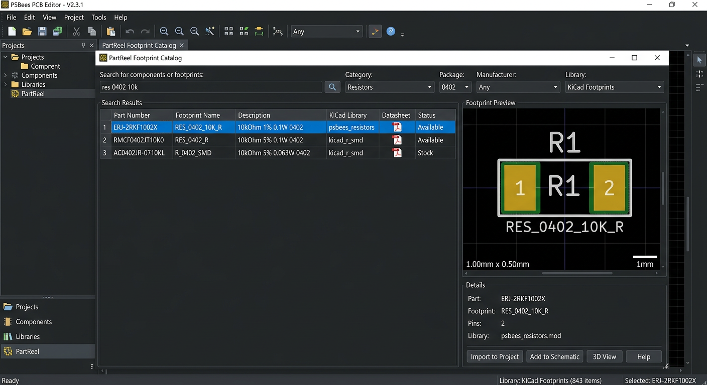
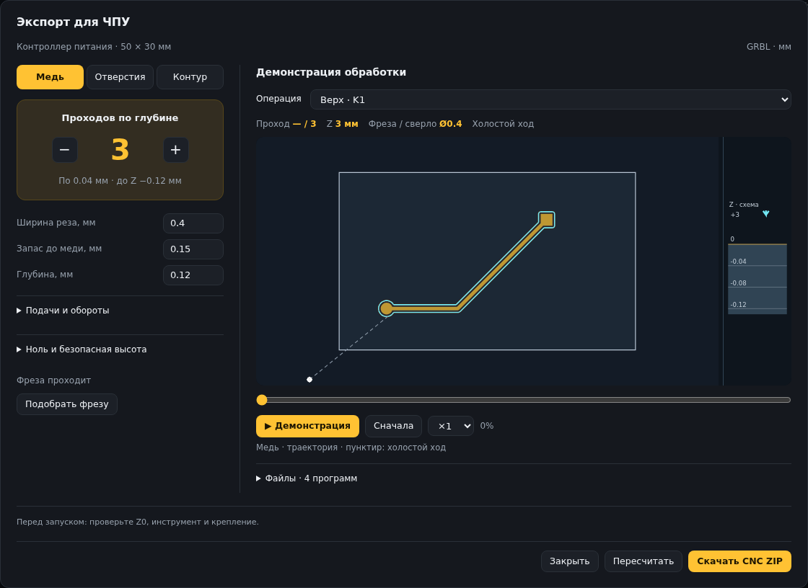
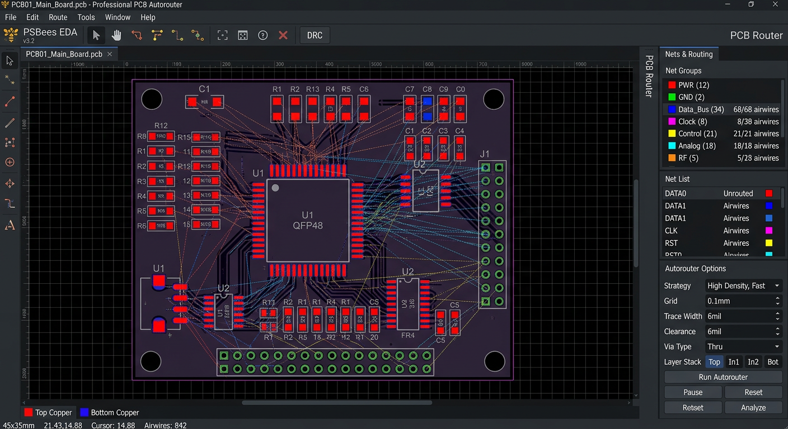
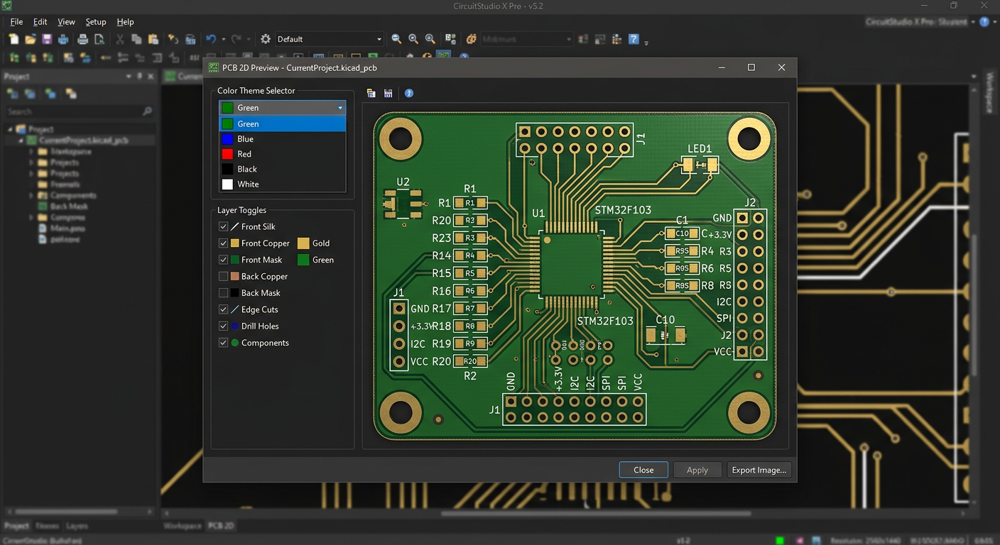
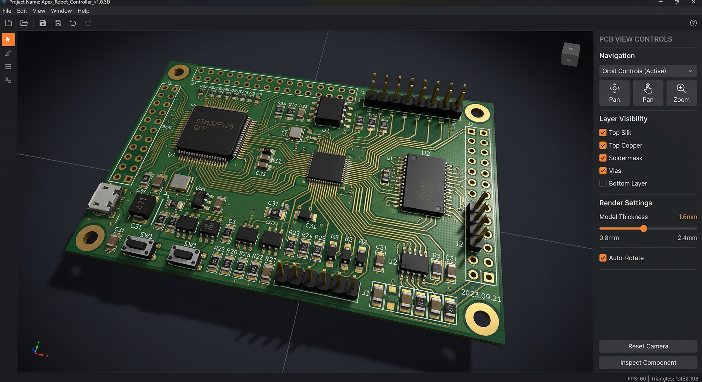
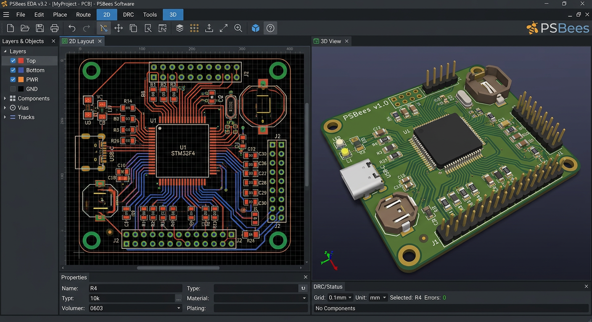

<p align="center">
  
</p>
<h1 align="center">PSBees — редактор печатных плат для Linux и Windows</h1>

<p align="center">
  <br/>
  <em>Тёмная тема — основной интерфейс с платой, слоями и свойствами</em>
</p>

## Скриншоты

<table>
<tr>
<td align="center"><br/><sub>Главный редактор (тёмная тема)</sub></td>
<td align="center"><br/><sub>Светлая тема</sub></td>
</tr>
<tr>
<td align="center"><br/><sub>Генератор деталей — строка → footprint</sub></td>
<td align="center"><br/><sub>Онлайн-каталог PartReel</sub></td>
</tr>
<tr>
<td align="center"><br/><sub>ЧПУ: проходы и встроенная демонстрация</sub></td>
<td align="center"><br/><sub>Автотрассировка и группы соединений</sub></td>
</tr>
<tr>
<td align="center"><br/><sub>2D предпросмотр — разные цвета маски (зелёная, синяя, красная, чёрная, белая)</sub></td>
<td align="center"><br/><sub>3D предпросмотр — объёмная плата прямо на сайте (Three.js)</sub></td>
</tr>
<tr>
<td align="center" colspan="2"><br/><sub>Объединённый предпросмотр — вкладки 2D (цвета и слои) и 3D (объём) прямо на сайте</sub></td>
</tr>
</table>

Веб-приложение для черчения (разводки) печатных плат в духе **Sprint-Layout**.
На Linux работает в браузере; на Windows — как обычная программа **`PSBees.exe`**
с установщиком **`PSBees-Setup.exe`**. Есть **общий сервер для нескольких компьютеров**
с входом и регистрацией по нику (без почты), облачным сохранением проектов, общей библиотекой деталей
для всех пользователей и отдельной админ-панелью ([инструкция по развёртыванию](DEPLOY_SERVER.md)).
Фирменный стиль «пчелиный»:
две темы — **тёмная** (по умолчанию) и **светлая**, переключаются кнопкой в шапке.

В программе три режима работы — переключатель в шапке:
**Платы** (этот редактор), **Чертежи** (векторный редактор чертежей и развёрток
в духе CorelDRAW: точный **DXF**, **PDF**, **EPS**, **PLT** и **SVG** —
[подробно](DRAWING_EDITOR.md))
и **3D моделирование** (твердотельное 3D корпусов — **скоро в разработке**).
Генератор коробок открывается отдельным окном из тулбара редактора чертежей
(`Ctrl+B`). Плата при переключении режима не теряется.

> Бренд: исходный логотип — `assets/logo.png`, все иконки и фавикон генерируются
> из него командой `npm run icons` (`scripts/make-icons.py`).

## Запуск

> **Windows:** скачайте установщик **`PSBees-Setup.exe`** (ярлык в «Пуск», запуск `PSBees.exe`)
> или портативный **`PSBees-portable.exe`**. Пошагово: **[INSTALL_WINDOWS.md](INSTALL_WINDOWS.md)**.
> Сборка установщика на машине с Windows: `npm run dist:win` → папка `release/`.
> Чтобы GitHub сам собирал оба `.exe`, скопируйте `scripts/win/windows.yml` в `.github/workflows/windows.yml`.

> **Впервые в Linux или никогда не открывали терминал?**
> Вам сюда: **[пошаговая инструкция для новичков → INSTALL_UBUNTU.md](INSTALL_UBUNTU.md)** —
> как установить Node.js, скачать и запустить программу, обновить и удалить её,
> и что делать, если что-то пошло не так.

### Коротко: установка на Ubuntu

Нужен `git`, чтобы скачать проект. Установщик сам подтянет свежие коммиты из GitHub
(`git pull`, если это git-копия), скачает Node.js 24 LTS и npm (если их нет), все библиотеки
проекта, соберёт приложение и создаст ярлык в меню приложений и на Рабочем столе (если папка
доступна). Для установки Node.js может потребоваться пароль администратора; подробности —
в [инструкции](INSTALL_UBUNTU.md).

```bash
git clone https://github.com/danilka-revin/linux_pcb_app.git ~/linux_pcb_app
cd ~/linux_pcb_app
bash install-ubuntu.sh   # сборка + установка + ярлык в меню «Приложения» (без sudo!)
```

После установки приложение запускается **одним кликом** на ярлык
«PSBees — редактор печатных плат» в меню приложений Ubuntu
или командой `psbees` в терминале.
Файлы ставятся в `~/.local/share/psbees`, лаунчер — `~/.local/bin`,
ярлык — `~/.local/share/applications`. Локальный сервер поднимается сам
и повторно использует уже запущенный экземпляр (порт 8484; другой порт —
`PCB_APP_PORT=8485 bash install-ubuntu.sh`, журнал — `~/.local/share/psbees/server.log`).

Обновление: `bash install-ubuntu.sh` (свежие коммиты подтянутся сами) или, если хочется
вручную, `git pull && bash install-ubuntu.sh`. При запуске приложение тоже проверяет
GitHub и обновляется само — так что переустановка из давно не обновлённой копии больше
не откатывает программу на старую версию.

Программа сама следит за обновлениями: как только в ветке `main` появляется новый
коммит, кнопка **«Обновить»** в шапке загорается и пульсирует, а в углу окна
появляется напоминание с версией и числом новых коммитов (проверка — через пару
секунд после запуска, дальше раз в полчаса и сразу при возврате в окно). «Позже»
убирает напоминание, но кнопка остаётся подсвеченной, пока вы не обновитесь.

Быстрый запуск без установки ярлыка (тоже «одной командой»):

```bash
bash run.sh              # соберёт dist при необходимости и откроет браузер (порт 8080)
```

### Режим разработчика

```bash
npm install
npm run dev        # http://localhost:5173
```

Сборка продакшн-версии: `npm run build` → `dist/` (статика, можно раздавать любым сервером,
например встроенным: `npm run start` — http://localhost:8080, проверка: `/healthz`).

### Общий сервер с пользователями и совместными проектами

Поднять общий сервер для нескольких людей (с базой проектов, общей библиотекой деталей
и совместным редактированием) можно **одной командой без настройки почты и паролей**:

```bash
bash run-server.sh       # соберёт и запустит общий сервер в фоне (порт 8080)
```

или установить как постоянную службу Ubuntu (тоже одной командой без лишних вопросов):

```bash
git clone https://github.com/danilka-revin/linux_pcb_app.git ~/linux_pcb_app
cd ~/linux_pcb_app
sudo bash server-ubuntu.sh install
```

Люди в сети открывают адрес сервера (например, `http://192.168.1.50:8080/`), вводят
своё **имя (ник)** и сразу начинают работать — почта, SMTP и пароли не требуются.
Первый вошедший пользователь автоматически становится администратором (`/admin`).
Для совместной работы владелец в **«Проекты → Участники»** добавляет коллегу по его
нику; вдвоём можно редактировать одну плату с почти мгновенной синхронизацией и
слиянием независимых изменений.

Управление службой и резервное копирование: `sudo bash server-ubuntu.sh status|logs|update|backup`
(подробности в [DEPLOY_SERVER.md](DEPLOY_SERVER.md)).
Обычный `.laypcb.json`, Linux/Electron-офлайн режимы продолжают работать без учётной записи.

Тесты: `npm test` (логика + генератор деталей + SSR + круговая совместимость
`.lay6`/`.lmk` на реальных файлах Sprint-Layout из `test/fixtures`).

Проверки 3D без браузера: `npm run test:3d` (также входят в `npm test`).
Проверки реального WebGL-рендера, вращения, масштаба, переключения режимов и ошибок:

```bash
npx playwright install --with-deps chromium   # один раз на машине для тестов
npm run test:preview-browser                 # временный Vite-сервер на порту 5174
```

Для уже запущенного сервера задайте `PSBEES_TEST_URL=http://127.0.0.1:5173`;
при необходимости `PSBEES_TEST_BROWSER=/путь/к/chromium` выбирает установленный браузер.
3D-просмотр требует **WebGL 2**. Если он отключён или графический контекст потерян,
окно показывает причину и кнопку повторного запуска; 2D остаётся доступен.

В 3D детали получают **процедурные корпуса с текстурами и маркировкой**:
микросхемы, резисторы, диоды, конденсаторы, светодиоды, транзисторы,
разъёмы/гнёзда, клеммники, кнопки, переключатели, кварцы, реле, катушки и модули.
Тип определяется по имени, библиотеке и надписям посадочного места, выводы —
по реальным площадкам. Для неизвестных деталей используется универсальный
текстурированный корпус; крепёжные отверстия и метки корпусами не закрываются.
Модели работают офлайн и учитывают поворот и нижнюю сторону платы.
Это приближённая визуализация, **не точные модели производителя** и не проверка
механических зазоров. Автотесты `test:3d` охватывают все семейства генератора.

Сверловка в 3D — **настоящие сквозные отверстия** в подложке: площадки,
переходные и крепёжные отверстия (включая выводы деталей) прорезаны на всю
толщину, сквозь них видно фон и выводы деталей. Стенки металлизированных
отверстий (площадки, переходные) показаны медью, у неметаллизированных
(крепёжные, площадки «без металлизации») — голый текстолит. Отверстия, которые
пересекаются друг с другом или выходят за край платы, остаются только
нарисованными на поверхности, чтобы сетка платы всегда была корректной.
Большие платы (тысячи отверстий) строятся быстро за счёт разбиения на участки.

**Экспорт 3D-модели с текстурами** — кнопки под панелью 3D-просмотра
(экспортируется то, что на экране: выбранная тема, толщина, отверстия и,
если включена галочка «Детали», корпуса деталей):

| Формат | Что внутри | Единицы / оси | Где открыть |
|---|---|---|---|
| **GLB (glTF 2.0)** | один файл: геометрия, PBR-материалы, PNG-текстуры верха, низа и корпусов | метры (реальный размер), Y вверх | Blender, Windows 3D Viewer, three.js/Babylon, онлайн-просмотрщики glTF |
| **OBJ + MTL (zip)** | `.obj`, `.mtl` и папка `textures/` с PNG | миллиметры, Y вверх | Blender, 3ds Max, Cinema 4D, MeshLab и др. |

Центр платы — в начале координат. Модель визуальная (для рендеров и презентаций),
это не STEP для механических САПР.

## Совместимость со Sprint-Layout (.lay6 / .lmk)

- **Открытие плат Sprint-Layout 6 (`.lay6`)** — кнопка «Открыть» (или перетаскивание
  файла выбором). Конвертируются площадки THT/SMD, дорожки, полигоны, окружности/дуги,
  тексты (в т.ч. повёрнутые), отверстия, контур; координаты автоматически центрируются
  на платы.
- **Сохранение в `.lay6`** — Ctrl+E → «Сохранить плату как .lay6». Файл открывается
  в Sprint-Layout 6: тексты пишутся с векторными глифами (как у самого Sprint),
  медь/шелкография/контур — с родными типами объектов.
- **Макросов как отдельной системы больше нет**: корпус описывается одной строкой,
  а деталь рисует генератор (см. «Генератор деталей»). Файл `.lmk` из Sprint-Layout
  можно загрузить в свою библиотеку (кнопка «Импорт» над деревом деталей) — он
  станет обычной деталью: её так же ставят на плату, переименовывают, переносят
  по папкам и правят как обычно.
- Строки — в ANSI CP1251 (как в оригинале), повороты текстов — конвертируются из
  «по часовой» системы lay6.


## Режимы работы: платы · чертежи и развёртки · 3D

В шапке программы — переключатель рабочего пространства. Режим запоминается,
а проект режима плат (черновик, облако, история) при переключении сохраняется.

| Режим | Что это |
| --- | --- |
| **Платы** | редактор печатных плат: дорожки, компоненты, автотрассировка, DRC, Gerber, Excellon, фрезеровка ЧПУ |
| **Чертежи** | векторный редактор чертежей и развёрток: DXF, PDF, EPS, PLT, SVG — [DRAWING_EDITOR.md](DRAWING_EDITOR.md) |
| **3D моделирование** | твердотельное 3D-моделирование корпусов — **скоро в разработке** (экран с планом работ и переходом к 3D-виду платы) |

### Режим чертежей коротко

- **Инструменты как в CorelDRAW**: выбор, **«Форма» (F10)** с узлами и рычагами
  Безье, **«Усечь кривую» (X)** — trim/extend/break по настоящим пересечениям
  (в том числе по краю стола и по самопересечениям, с разбивкой всех кривых по
  пересечениям `Ctrl+Shift+X`), перо, отрезок, прямоугольник, эллипс/дуга,
  многоугольник и звезда, текст штриховым шрифтом, размерные линии, панорама.
  Привязка к узлам объектов и к сетке (когда её шаг различим на экране), `Alt` —
  без привязки. Инструмент рисования **остаётся активным** после фигуры — можно
  рисовать подряд, `V` или `Esc` возвращают к выбору; клик без протяжки ставит
  объект заданного размера (квадрат 20×20 мм, окружность Ø20 мм).
- **Вспомогательные линии (`A`)** — построения как в CAD: **перпендикуляр**,
  **параллель** (в том числе на точное расстояние), **касательная** к окружности,
  эллипсу, дуге или кривой Безье, направление **под углом**, **серединный
  перпендикуляр**, **биссектриса**, **горизонталь** и **вертикаль**; режимы —
  цифры `1`…`8`, длина и «на весь лист» — в панели построения. Линии попадают на
  служебный слой **«Вспомогательные»**, рисуются пунктиром и **не идут в
  экспорт**: это разметка, а не контуры детали.
- **Булевы операции и контур**: объединение (Weld), вычитание (Trim),
  пересечение, исключение (XOR), эквидистанта с **компенсацией керфа**,
  скругление углов (Fillet), **«В кривые» (Ctrl+Q)**, выравнивание и
  распределение, порядок объектов, группы, размножение массивом
  (Step & Repeat), **автораскладка** деталей на листе.
- **Генератор развёрток — отдельное окно** (кнопка «Развёртка» в тулбаре,
  предпросмотр раскладки и сводка, 7 параметрических шаблонов): складная коробка с
  клапанами и линиями сгиба, **корпус на шипах** с расчётом шип-паз под толщину
  листа и зазором посадки, П-образное шасси под печатную плату с вентиляцией,
  развёртка цилиндра и усечённого конуса, лицевая панель прибора с окном
  дисплея и шкалами, **гибкий рез (живой шарнир)**, зубчатое колесо по
  модулю и числу зубьев. Отверстия под плату — по базе и диаметру винта.
- **Генератор коробок — отдельное окно (подписанная кнопка «Коробки» в своей группе тулбара или `Ctrl+B`)**:
  студия с каталогом из **28
  параметрических генераторов** (450 настроек) в духе box.laserbiz.ru /
  boxes.py: универсальная, закрытая, закруглённая по секциям, U-образная с
  гнутым дном, со скошенной крышкой; крышка-нахлобучка, коробка с бортиком,
  петли-гребёнки и встроенный живой шарнир; выдвижной ящик, лоток с захватами
  и штабелируемыми ножками, лоток для бумаг, лоток с разделителями; монтажный
  короб, рэковый корпус 19″ с ушками, лицевая панель, перфорация, стойка для
  плат; крепление NEMA, панель на ласточкином хвосте, зубчатая пара;
  скворечник, корзинка для приборов, салфетница, катушка; вогнутая ручка и
  настенный держатель. Настоящий расчёт шип-паз и ласточкина хвоста: подрезка
  углов, люфт, коррекция обгара, отступ от края, удлинение шипа, нечётное
  симметричное число пальцев. Живой предпросмотр — **3D-сборка, которая
  крутится мышью**, и раскладка на листе в масштабе; статистика (детали, метры
  контуров и линий сгиба, габарит, число листов), подбор листа под раскрой. Собранная
  коробка гарантированно **не имеет пересечений деталей** — это проверяет
  `npm run test:boxes` сеткой по всему объёму сборки для всех типов. Окно работает
  со своим листом, поэтому коробку можно собрать и забрать, не заходя в рисовалку.
  Вывод: точный **DXF**, SVG 1:1 мм или «Перенести в рисовалку».
- **Свои слои чертежа**: в новом чертеже один слой «Слой 1», дальше добавляйте
  свои — «Слой 2», «Слой 3», … Кнопка **«Слой»** под списком, переименование
  прямо в строке слоя, удаление (объекты переходят на оставшийся слой), цвет из
  палитры, видимость и блокировка. У слоя есть **тип линии** — рез, сгиб
  (пунктир со своим штрихом и пропуском), разметка, заливка или служебный; имя и
  тип линии попадают в DXF, PDF, EPS, PLT и SVG (имя транслитерируется:
  «Слой 1» → `SLOY_1`). Вкладки левой панели — **«Объекты»** (по умолчанию) и
  **«Слои»**. От материала рисовалке нужна только **толщина**: её берут
  генератор развёрток и генератор коробок (шипы, пазы, клапаны, зазоры).
  Кнопки слоя в шапке нет — слой выбирают во вкладке «Слои», активный виден
  в строке состояния.
- **Экспорт чертежа (`Ctrl+E`) — DXF, PDF, EPS, PLT, SVG и свой проект**: основной вывод — полноценный файл AutoCAD R2000/R12 с
  настоящими `CIRCLE`, `ARC`, `ELLIPSE`, `SPLINE` и скруглениями бульджами,
  миллиметрами 1:1 (`$INSUNITS`, `$MEASUREMENT`), своими слоями чертежа (имена
  транслитерируются), цветами ACI или точным RGB, типом линии `DASHED` для линий
  сгиба, блоками `INSERT` для одинаковых деталей и
  отдельными файлами по слоям — архив `.zip`, по файлу на каждый слой
  (удобно для CAD-программ и CorelDRAW). Все параметры DXF настраиваются в самом
  диалоге «Экспорт чертежа»: там же видны план файла (слои, цвета ACI, типы
  линий, число объектов) и режим вывода — один `.dxf` или архив по слоям.
  Встроенный **контроль точности** сравнивает
  геометрию файла с исходной и показывает отклонение в миллиметрах (обычно
  0.00001 мм), габарит, длину реза и состав сущностей — в диалоге экспорта он
  пересчитывается на лету после каждой правки настроек. Дополнительно **SVG
  1:1 мм** и проект `.psdraw` (`Ctrl+S`; прежние `.pslaser` открываются).
  **Импорт** SVG и DXF из CorelDRAW, Inkscape, AutoCAD (включая `INSERT`,
  `POLYLINE`, `SPLINE`); векторизация растрового логотипа (аналог PowerTRACE).
- **Обмен с CorelDRAW — PDF, EPS и PLT**: векторный **PDF 1:1 мм** (кривые Безье
  без аппроксимации, слои чертежа становятся слоями PDF — OCG), **EPS 3.0**
  (PostScript с `%%BoundingBox`, метками слоёв и пунктиром линий сгиба) и
  **PLT/HPGL-2** (40 юнитов на мм, перо на каждый слой, пунктир настоящими
  пропусками пера). **Импорт** — из PDF, EPS/AI (PostScript, включая
  Illustrator: матрицы, процедуры пролога, дуги, формы XObject, сжатые потоки
  FlateDecode), PLT/HPGL (полилинии, дуги `AA`, окружности `CI`, масштаб `SC`),
  SVG и DXF. Слои возвращаются по именам OCG и меткам `%PSBeesLayer`, а пунктир
  и цвет линии распознаются как слой сгиба. Родной `.cdr` закрытый (двоичный,
  без публичной спецификации) — редактор не гадает, а подсказывает, в какой
  формат пересохранить файл из CorelDRAW.
- **Станочная часть сохранена в коде, но скрыта из интерфейса**: керф
  (компенсация толщины инструмента) и удерживающие перемычки, мощность,
  скорость, проходы и обдув слоя, фиксированные роли слоёв CUT/INNER/FOLD/
  SCORE/ENGRAVE/GUIDE, G-Code для
  GRBL/LightBurn/LaserGRBL (M3/M4, `S` по мощности, проходы, `M8`/`M9`,
  оптимизация холостых переездов, возврат в ноль), симуляция обработки с
  реальной траекторией головки (ускорение ×1…×256, длина реза, холостой ход,
  время по слоям), PNG-чертёж, панель задания на станок и таблица режимов
  резки по материалам. Возвращается одним флагом `MACHINE_UI` в
  `src/laser/features.ts`.

Координаты — миллиметры, `Y` вверх, `(0;0)` — левый нижний угол листа.
Полное описание, таблицы режимов и горячие клавиши: **[DRAWING_EDITOR.md](DRAWING_EDITOR.md)**.

## Возможности

### Рисование
- **Дорожки** — ширина настраивается, режимы углов 45° / 90° / свободно,
  смена слоя на лету клавишей `L` с автоматической установкой переходного отверстия
- **Узлы дорожек и вершины полигонов** (инструмент «Выбор», клавиша `1`) —
  выберите одиночную дорожку или полигон, затем тяните квадратный узел мышью
  (привязка к сетке, `Alt` — без неё, `Shift` — строго по горизонтали/вертикали).
  Двойной клик по звену добавляет узел (точка притягивается к сетке и проецируется на звено,
  `Alt` — без привязки). Двойной клик или правая кнопка по узлу удаляет его;
  Из любого узла можно начать **ответвление**: выберите узел → **«Ответвление от узла»**
  справа, либо инструментом «Дорожка» (`2`) кликните по узлу и ведите ветку.
  Она наследует ширину и слой исходной дорожки, точно соединяется с узлом даже вне
  сетки и входит в ту же электрическую цепь. При перемещении общего узла мышью
  или через X/Y связанные ветки перемещаются вместе с ним. ПКМ/Esc завершает ветку;
  Ctrl+Z отменяет её целиком. Также можно закончить дорожку на любом узле того же слоя.
  Выбранный узел можно удалить `Del` или кнопкой в свойствах. `Esc` снимает выбор узла,
  после чего `Del` удаляет целую дорожку.
- **Разрыв и пайка** — инструмент «Разрыв» (клавиша `X`) вырезает в любом месте дорожки зазор
  под амперметр (ширина задаётся справа, опционально ставятся площадки под провода щупов),
  инструмент «Пайка» (клавиша `S`) соединяет концы обратно прямой перемычкой. Всё отменяется через `Ctrl+Z`
- **Автотрассировка** (инструмент «Автотрассировка», клавиша `9`): клик по первой
  площадке → клик по второй, и дорожка прокладывается сама по заданным параметрам
  (ширина, зазор, шаг сетки, 45°/90°, размеры переходного отверстия). Клик в пустое место ставит
  новую площадку с отверстием (место под перемычку/джампер).
  В режиме **«Группы / вся плата»** ширина дорожки задаётся **для каждой группы отдельно**
  (поле «мм» в строке группы), плюс можно переопределить зазор, размеры перехода и
  разрешение верхнего слоя. Пустое поле правила = общее значение из настроек справа.
  **Поиск пути стал умнее:** сначала прокладываются группы с широкой дорожкой, связь может
  подключиться ветвью к уже проложенному стволу своей группы, дорожка держится подальше от
  чужой меди (оставляя место следующим), а при перекрытии прохода автотрассировщик снимает
  **свои же** дорожки текущего расчёта, освобождает проход и перекладывает задетые группы —
  медь пользователя и прошлых запусков не снимается никогда. Если при грубом шаге сетки узлы
  не попадают в промежуток, поиск повторяется со сдвигом сетки на полшага.
  **Приоритет — нижний слой K2 (сторона пайки):** в заданные площадки-«пяточки»
  (не переходы) дорожка входит **только по нижнему слою K2**, к SMD-площадке — **по слою
  самой площадки**, а переходные отверстия («мостовые») доступны с любого слоя. Для обхода
  препятствий дорожка может уходить на верх (K1) через переходные отверстия. Два отдельных
  зазора: **до чужих дорожек** и **до отверстий** (площадки с
  отверстием, переходы, крепёжные отверстия) — отсчитываются от края меди/отверстия,
  результат проверяется (DRC). При выбранном инструменте вокруг отверстий рисуется
  оранжевый пунктир — граница, ближе которой дорожка не пройдёт.
- **Тест цепи** (инструмент «Тест цепи», клавиша `0`): клик по любой меди — дорожке,
  площадке, переходу, SMD или выводу компонента — подсвечивает мигающим фиолетовым всю электрически
  связанную с ней медь (все «касающиеся» пятки и дорожки, включая выводные площадки
  компонентов): видно, как пойдёт ток. Счётчик состава цепи — в строке состояния,
  клик мимо или `Esc` снимает подсветку. При системной настройке уменьшения движения
  фиолетовая подсветка остаётся постоянной (без мигания).
- **Тепловизор** (инструмент «Тепловизор», клавиша `T`): клик по меди — и цепь
  раскрашивается по нагреву при заданном токе, как на тепловизоре: от синего
  к красному. Белый пунктир бежит по дорожкам от точки клика — видно направление
  тока. Справа — ток цепи, толщина меди и допустимый нагрев, а также итоги:
  сопротивление цепи, падение напряжения, мощность, максимальный нагрев и список
  участков от горячих к холодным (клик по строке центрирует участок).
  Расчёт — обратный IPC-2221 и R = ρ·L/A при 20 °C; это прикидка «сверху»
  (каждый участок якобы несёт весь ток), переходы и теплоотвод в полигоны
  не учитываются. Клик мимо или `Esc` снимает раскраску.
- **Контактные площадки** — круг / квадрат / восьмиугольник, с металлизацией (на обоих слоях, в сверловке)
- **SMD-площадки**, **переходные отверстия**, **монтажные отверстия**
- **Линии, прямоугольники, окружности** на шелкографии и контуре
- **Залитые полигоны** (сплошная медь, «земляной» полигон) на любом слое меди
- **Текст** на шелкографии: высота, толщина, поворот, зеркальный; кириллица поддерживается
  (в Gerber экспортируется векторным шрифтом)
- **Размерные линии** (инструмент «Размер», клавиша `U`): три клика — первая точка,
  вторая точка и место размерной линии. Направление — «по точкам», горизонтально
  или вертикально; подпись с размером рисуется автоматически (своя — в свойствах).
  Размер остаётся примитивом платы: его двигают, поворачивают (`R`), зеркалят (`M`)
  и правят в свойствах (точки, смещение, толщина, текст). Размеры живут на своём слое
  (шелкография/контур) и попадают в **печать PNG** и **Gerber** вместе с ним

### Слои и вид
- 2 слоя меди (K1 — красный, K2 — зелёный) + 2 шелкографии (Ш1/Ш2) + контур платы
- **Односторонняя плата (1 слой меди)** — переключатель «Слоёв меди» в панели «Слои»
  и в свойствах платы, а также в диалоге «Новая плата». Вся медь остаётся на K2
  (сторона пайки): K1 помечается как неиспользуемый, активным слоем становится K2,
  переход-«мост» не ставится, автотрассировка ищет путь в одном слое, DRC подсвечивает
  медь на K1 как ошибку, а в Gerber не попадает файл верхней меди. Так делают ЛУТ,
  фоторезист и одностороннюю фрезеровку. Нарисованная на K1 медь не удаляется —
  её переносит пользователь, а не программа
- Видимость слоёв, активный слой меди
- **Вид снизу** — зеркальное отображение всей платы
- Сетка 0.25…5.08 мм с привязкой (`Alt` — временно без привязки)
- **Привязка к объектам** (включена по умолчанию, «Сетка и привязка» в настройках):
  курсор прилипает к **концам, серединам, центрам, углам и пересечениям** дорожек и
  графики; тип точки показывается подписью у курсора. `Alt` — временно без привязки
- **Направляющие при перетаскивании**: край или центр выделения почти совпал с чужим
  краем/центром — выделение прилипает точно, на холсте проступают тонкие направляющие
- Координаты одновременно в **мм и mil**, масштаб колесом, панорама средней кнопкой

### Правка
- Отмена/повтор (Ctrl+Z / Ctrl+Y), выбор рамкой, перенос мышью и стрелками
- Копировать/вставить (Ctrl+C / Ctrl+V), дубль (Ctrl+D), поворот 90° (R)
- **Группы элементов** — связать выделенное в группу (Ctrl+Shift+G) и распустить
  (Ctrl+Shift+U): группа выбирается кликом по любому её элементу и двигается,
  поворачивается и удаляется целиком
- **История правок списком** (Ctrl+Shift+H): все операции пронумерованы и подписаны
  («Добавлена дорожка», «Перемещение объектов: 3»), состояние можно вернуть к любой
  строке одним щелчком — жать Ctrl+Z десять раз не нужно
- Перенос на другую сторону платы (M), редактирование свойств в панели справа
- **Панелизация** — размножение платы сеткой с заданным шагом

### Интерфейс
- Верхняя панель — всегда в одну строку: файл, генератор деталей, отмена/повтор,
  сетка и углы, слой K1/K2, вид, тема и «Обновить». Редкие действия (экспорт
  Gerber/PNG, панелизация, перечень площадок, конструктор интерфейса, цвета
  интерфейса, «О программе») спрятаны в выпадающие меню «⋯» рядом со своими
  группами. Если окно уже, чем кнопки, первым сжимается логотип с подписью, а
  последняя группа (тема, «Обновить», «⋯») прилипает к правому краю — ничего не
  пропадает за краем окна
- **«Обновить» загорается само**: вышла новая версия на GitHub — кнопка в шапке
  подсвечивается и пульсирует, рядом появляется счётчик новых коммитов (`+3`),
  а в правом нижнем углу — напоминание с версией и текстом последнего коммита.
  «Позже» скрывает напоминание до следующей версии, подсветка кнопки остаётся
- Все настройки — в **отдельном окне** (шестерня в шапке или `Ctrl+,`): тема,
  сетка, курсор, слои, объекты, трассировка, экспорт, горячие клавиши,
  перенос настроек файлом и сброс — см. раздел [«Настройки»](#настройки-отдельное-окно)
- Меню **«⋯» → «Конструктор интерфейса…»** (порядок и видимость групп кнопок,
  боковые колонки) и **«Цвета интерфейса…»** (акцент, фон, панели, текст) —
  эта последняя группа не скрывается конструктором: иначе вход в сами настройки
  пропал бы вместе с ними. Старый сохранённый порядок кнопок не может спрятать
  группы, появившиеся в новой версии, — они дописываются в конец панели
- **Инструменты рисования — в вертикальном доке слева у холста** (как в
  Sprint-Layout): выбор и анализ → медь → графика → измерения и компоненты;
  подсказки с горячими клавишами `1…9`, `0` при наведении
- Предпросмотр платы — **одна кнопка в шапке** (2D и 3D в одном окне): клик по
  ней открывает окно в том режиме, который смотрели последним, узкая стрелка
  справа сразу выбирает режим — «2D предпросмотр — Sprint Layout» или
  «3D предпросмотр — объёмная плата». Внутри окна режимы переключаются
  кнопками, и выбор запоминается для следующего открытия
- Отрисовка в два слоя: сетка и плата кэшируются на базовом холсте и не
  перерисовываются при движении мыши; сетка рисуется батчами с выравниванием
  по device-пикселям (чёткие точки/линии на любом DPI, без лагов при панорамировании)
- Предпросмотр детали — **всплывающим окном** (глаз в панели «Детали» или клик по
  детали в библиотеке): крупный вид с фоном-сеткой, точкой привязки (0;0),
  габаритной рамкой с размерами в мм и масштабной линейкой, выбором поворота и
  стороны; кнопка «Поставить» ставит деталь в центр вида и выделяет её.
  Предпросмотр в диалоге сетки показывает ровно настроенный шаг с подразбиением
  и «главными» линиями

### Обучение — добровольное, прямо в редакторе

Ничего не запускается само и ничего не блокируется: урок только предлагает
помощь, а дальше подсвечивает нужную кнопку и **ждёт настоящего действия**
на живой плате (не картинка и не лекция — та же механика, что в «Твоей первой
дорожке»).

- Шесть коротких практик: `✏️ Твоя первая дорожка`, `🧩 Поставить деталь из
  генератора`, `🖱️ Мышь, зум и выделение`, `🗂️ Слои, глазик и переходы`,
  `⚡ Автотрассировка за два клика`, `💾 Сохранить и отдать в работу`
  — код в `src/ui/coach.tsx`, список и шаги: `PRACTICES`
- Пока есть непройденные уроки, **внизу окна** (под холстом, над строкой
  состояния) висит полоса «🐝 Пройти обучение · N уроков по минуте…» с кнопками
  **Пройти обучение / Пропустить**. Она ничего не перекрывает и не блокирует.
  Нажали «Пропустить» — полоса больше не всплывает, уроки остаются в
  **Настройки → Обучение**; полоса исчезает сама, когда все шесть пройдены
- В **Настройки → Обучение** («Полоса «пройти обучение» внизу окна»): *Показывать*
  (по умолчанию), *Сразу показывать* (первый непройденный урок стартует сам),
  *Не показывать* — настройка `learnOnStart` в `psbees.prefs`
- Любой шаг пропускается («пропустить шаг →»), весь урок закрывается `Esc` или
  крестиком; пройденное и пропущенное запоминается в `psbees.practices.done`,
  сброс — там же, в разделе «Обучение»
- Каждый теоретический тур связан со своей практикой: в окне тура кнопка
  «🎯 Практика ▶» сразу запускает урок в редакторе

### Настройки (отдельное окно)

Кнопка **шестерня** в шапке (или `Ctrl+,`, или меню «⋯» → «Настройки…») открывает
**отдельное окно настроек** — его можно двигать за шапку, тянуть за правый нижний
угол, разворачивать на весь экран и выносить в настоящее окно браузера (кнопка
в шапке окна; в Windows-сборке это отдельное окно программы). Окно не модальное:
плата за ним продолжает работать, а правка видна сразу — перезапуск не нужен.
Есть поиск по настройкам (поле над списком разделов).

| Раздел | Что настраивается |
| --- | --- |
| **Обучение** | список практических уроков с отметками о прохождении и их сброс, напоминание об обучении при запуске (*Спросить* / *Сразу показывать* / *Не показывать*), туры с демонстрациями, шпаргалка терминов — см. раздел [«Обучение»](#обучение--добровольное-прямо-в-редакторе) |
| **Общие** | тема (тёмная/светлая), акцентный цвет и цвета фона/панелей/текста, восстановление прошлой платы при запуске, автосохранение и его интервал, глубина истории отмены, подтверждение удаления, проверка обновлений |
| **Пресеты** | 30 готовых тем оформления (Пчела, Полночь, Nord, Dracula, Monokai, Tokyo Night, Catppuccin, Gruvbox, GitHub, Rosé Pine, Everforest, Неон, Матрица, Фосфор, Solarized, Текстолит, Графит, Высокий контраст, Бумага, Небо, Мята, One Light, Лаванда, Персик…) с превью — тема красит и интерфейс, и холст (фон платы, сетку, выделение); свои темы; технология изготовления (ЛУТ, фоторезист, фрезеровка ЧПУ, заводская, плотный SMD, силовая); режимы сетки; вид интерфейса; печать 1:1; типовые размеры новой платы; **свои профили** — снимок всех настроек, который можно применить одним щелчком. После любого пресета внизу окна есть «Вернуть как было» |
| **Интерфейс** | компактный интерфейс, строка состояния и подсказка инструмента в ней, единицы координат (мм/mil/оба), док инструментов, порядок и видимость групп кнопок, вкладки и ширина боковых колонок |
| **Сетка и привязка** | шаг (92 пресета и своё значение), единицы, точки/линии/перекрестия/выкл., подразбиение, «главные» линии, начало сетки, привязка к сетке и к объектам с радиусом поиска, оси координат |
| **Холст и курсор** | перекрестие, плашка координат у курсора, колесо мыши (вкл./инверсия/шаг масштаба), качество отрисовки (авто/высокое/среднее/низкое) |
| **Слои** | активный слой меди (K1/K2) и видимость всех слоёв |
| **Новые объекты** | ширина дорожки и углы (45°/90°/свободно), площадка (форма, размер, сверло), переход, отверстие, SMD, линия, окружность, прямоугольник, текст, параметры разрыва |
| **Автотрассировка** | ширина дорожки, зазоры до меди и до отверстий, шаг сетки трассировки, цена перехода, штраф верхнего слоя, углы, площадка под джампер |
| **Контроль зазоров** | подсветка нарушений и минимальный зазор |
| **Файлы и экспорт** | размер и название новой платы, параметры печати 1:1 (слой, зеркало, метки центров, 300/600/1200 dpi) |
| **Горячие клавиши** | любые сочетания под себя: у каждого действия (файл, правка, инструменты, вид, окна) можно заменить клавиши, добавить второе сочетание или снять вовсе; занятое сочетание автоматически снимается с прежнего действия |
| **Данные и сброс** | сводка о плате и версии, выгрузка настроек в файл и загрузка из файла (перенос на другой компьютер), очистка черновика, сброс всех настроек |

Настройки хранятся в этом браузере: `psbees.prefs` (программа), `lauaut.defs`
(инструменты, сетка, трассировка), `lauaut.ui` (состав кнопок и панелей) и
`psbees.presets` (свои темы и профили — сброс настроек их не удаляет).
Файл настроек (`psbees-settings.json`) включает и свои пресеты, но не содержит саму
плату и библиотеку деталей. Быстрые пресеты продублированы в профильных разделах:
готовая тема — в «Общих», технология — в «Новых объектах» и «Автотрассировке»,
режим сетки — в «Сетке», вид — в «Интерфейсе», печать и размер платы — в «Файлах».

### Форма платы и слой «Контур платы»

Замкнутая геометрия слоя **«Контур платы»** задаёт физическую подложку в редакторе,
2D-предпросмотре и 3D, а также в экспорте GLB/OBJ. Измените размеры или положение
контура — форма подложки обновится; размеры рабочего поля не ограничивают её.

- Для новой формы выделите и удалите исходную прямоугольную рамку. Инструментом
  **«Линия»** на слое **«Контур платы»** нарисуйте замкнутую цепочку: конец последней
  линии должен совпасть с началом первой (используйте привязку к сетке).
- **Прямоугольник** и **окружность** на этом слое тоже задают форму платы.
  Толщина линии не меняет размеры подложки: край проходит по центру линии.
- Контур внутри внешнего контура создаёт **сквозной вырез**; несколько отдельных
  контуров — несколько участков платы. Не оставляйте старую рамку вокруг новой
  формы: вложенная форма будет считаться вырезом.
- Незамкнутые цепочки и развилки не участвуют в форме; появляется предупреждение.
  Если замкнутых контуров нет, используется прямоугольник размеров рабочего поля.
- В редакторе элементы за краем остаются доступны для исправления. В предпросмотре
  медь и маска обрезаются по форме подложки. Скрытие слоя контура скрывает его
  обводку, но не меняет форму платы. Сохранение проекта, отмена и повтор сохраняют
  контур как обычные редактируемые примитивы.

Это не расширяет возможности встроенного ЧПУ-экспорта: он по-прежнему вырезает
только поддерживаемый прямоугольник. Для сложной формы используйте Gerber и CAM.

### Генератор деталей и своя библиотека
Вкладка «Детали» слева. В строке пишешь, что нужно, — посадочное место собирается само:
площадки/выводы, шаг, размеры и форма площадок, корпус и шелкография, крепёжные
отверстия, подписи выводов и номинал.

```text
dip 8 шаг 2.54 2 крепёжных отверстия m3 подписи
soic-16 шаг 1.27
qfn 32 5x5 шаг 0.5 thermal
резистор 10ком 0.25вт
клеммник 4 контакта 5.08 без шелкографии
крепёжное отверстие m3 x4 шаг 20
плата 60x40 4 m3
esp32 devkit
blue pill
arduino mega 2560
```

- 22 семейства: DIP, SOIC/SOP/TSSOP, QFN/QFP/TQFP, SOT, чип-резисторы и конденсаторы
  0201…2512, выводные резисторы/диоды/конденсаторы, электролиты, кварцы (HC-49, 3225),
  тактовые кнопки, клеммники, штыревые и IDC-линейки, TO-220/TO-247, DIP-переключатели,
  реле, модули Arduino/ESP32/STM32 Blue Pill, шилд Arduino Uno, **посадочное место
  Arduino Mega 2560**, одиночные площадки и тестпоинты, метки совмещения,
  крепёжные отверстия, контур платы;
- всё читается из текста: «шаг 1.27», «ø3.2», «площадка 1.8/0.8», «60×40», «m3»,
  «2 крепёжных отверстия», «100mil», «шаг 100mil», «без шелкографии», «подписи каждые 2»,
  «низ»; единицы — мм, mil, см, дюймы. Что не распознано — показывается строкой
  «не учтено», а не ошибкой: «лишние» слова (номинал, назначение) просто игнорируются;
- под строкой — паспорт детали (выводы, шаг, диаметр сверла, габарит) и живые поля
  параметров: правка любого поля переписывает строку, `Enter` сразу ставит деталь
  на плату, кнопка «Справка» — список семейств со словами-синонимами и примерами;
- размеры берутся из IPC-7351-подобных таблиц (для чипов — по коду корпуса, для
  SOIC/QFP — по шагу), крепёж — по метрике (m2…m6 → сверло 2.2…6.4), у платы и
  модулей отверстия сами уходят в углы;
- **Своя библиотека**: «В мою библиотеку» сохраняет деталь в папку — папки и
  вложенные папки, переименование, перенос, поиск, сворачивание. Личная библиотека
  живёт в браузере; «Экспорт JSON»/«Импорт» дают резервную копию `library.json`.
  В общем облачном рабочем пространстве у каждой детали есть кнопка ☁: можно
  опубликовать одну деталь или сразу всю личную библиотеку. Вкладка **«Общая»**
  показывает библиотеку сервера всем пользователям: оттуда футпринт можно поставить
  на плату, посмотреть или скопировать себе. Опубликованную деталь может удалить её
  автор или администратор. Сохранённая локально деталь ставится кликом, кнопка ✎
  открывает её строку обратно в генератор — поправить шаг или крепёж можно,
  не перерисовывая корпус; «Обновить» перезаписывает деталь текущими размерами.
- Компонент устанавливается с поворотом (`R`) и выбором стороны (`Q`) — в
  предпросмотре видно, как он встанет; дальше копии добавляются кликами по плате.

### Онлайн-каталог футпринтов (PartReel)
Вкладка **«Каталог»** в панели «Детали» подключает публичный PartReel: его индекс содержит
21 668 записей и не требует API-ключа. При первом поиске сервер загружает и кэширует индекс
в своей памяти, затем локально фильтрует названия, производители, MPN, корпуса, категории и
ключевые слова. В браузер передаются только найденные метаданные (до 40 карточек). Есть быстрые
фильтры SMD и «Модули / датчики» и отдельный фильтр `verified`.

Выбранная карточка и конкретный `.kicad_mod` загружаются только после клика по компоненту.
Запросы идут через same-origin-прокси с кэшированием в `scripts/server.mjs` (в dev-режиме —
через прокси Vite), поэтому фронтенду не нужен прямой CORS-доступ к PartReel. Конвертер
поддерживает SMD, выводные и неплакированные отверстия, линии, прямоугольники, окружности,
дуги, полигоны и пользовательские подписи; номера площадок, слои паяльной маски/пасты и
некоторые нестандартные формы упрощаются. Ограничения конвертации показываются в карточке.

Данные компонентов PartReel распространяются по **CC BY 4.0**: сохраняйте указание источника
и provenance, отображаемые в карточке и личной библиотеке. Отметка `verified` — статус источника,
а не гарантия пригодности для производства: сверяйте габариты с даташитом. Каталог дополняет,
но не заменяет официальные библиотеки KiCad. Локальный генератор и свои макросы продолжают
работать без сети; интернет нужен только для онлайн-каталога.

### Файлы и производство
- Проект сохраняется/открывается как JSON (`.laypcb.json`); автосохранение в браузере
  в офлайн-режиме. На общем сервере — проекты в SQLite, обязательная почтовая 2FA и
  совместная работа двух участников с автоматическим слиянием независимых правок.
- **Sprint-Layout 6**: открытие и сохранение `.lay6`, `.lmk` грузится в свою библиотеку
- **Экспорт Gerber RS-274X** (оба слоя меди, обе шелкографии, контур) + **Excellon** сверловка
  — одним ZIP-архивом для заводского изготовления. Gerber — **не** G-code для станка.
- **Экспорт для фрезерного ЧПУ** (Файл → ⋯ → «G-code для фрезерного станка…», либо
  Ctrl+E → CNC ZIP): отдельный `.nc` для верхней изоляционной фрезеровки K1 и
  зеркальной нижней K2, **отдельный `.nc` на каждый диаметр сверла** без автоматической
  смены инструмента, необязательный файл выреза прямоугольного контура.
  Компактные вкладки «Медь / Отверстия / Контур»: **число проходов по глубине**, отдельные **проходы по ширине** для расширения канавки рядом с дорожками,
  диаметр и глубина; подачи и рабочий ноль — в раскрывающихся разделах.
  Встроенная **демонстрация из G-code** показывает все операции, текущий проход и Z,
  поддерживает паузу, скорость и перемотку; вид **приближается колесом и перемещается
  перетаскиванием** для проверки мелких участков. Есть кнопка «Подобрать фрезу».
  Параметры по умолчанию не гарантируют безопасность на вашем станке.
  **Как базировать и перевернуть плату, сменить сверло и выполнить пробный пуск:**
  [CNC_EXPORT.md](CNC_EXPORT.md). Диалект — GRBL-совместимый G-code.
- **Печать PNG 1:1** для ЛУТ/фотошаблона: 300/600/1200 dpi, зеркалирование, метки центров отверстий
- **Изображение → шелкография** (меню «⋯»): выберите логотип/картинку — она станет
  векторным рисунком на шелкографии (залитые фигуры с дырками у букв). Порог яркости,
  инверсия, ширина в мм, детализация и минимальный размер пятна настраиваются с живым
  предпросмотром; «Вставить» кладёт рисунок в буфер — кликните по плате, чтобы поставить
  (`R` — повернуть). Дальше это обычные полигоны на выбранном слое (Ш1/Ш2)
- **Статистика платы** (меню «⋯»): габарит и площадь подложки, длина дорожек по слоям,
  площадь меди и процент заполнения (точное объединение геометрии), число отверстий,
  состав элементов
- **Расчёт дорожки (IPC-2221)** в свойствах выбранной дорожки: допустимый ток с учётом
  ширины, толщины меди (18/35/70 мкм) и допустимого нагрева, сопротивление участка и
  падение напряжения; быстрая оценка для новых дорожек — в панели инструмента «Дорожка»

## Производительность на слабых устройствах
Редактор сам подстраивается под машину и не требует настройки — при этом **ни одна
функция не отключается**, меняется только качество отрисовки:
- **Профиль качества** (`Авто`, `Высокое`, `Среднее`, `Низкое`) — выбирается по числу
  ядер, объёму памяти, плотности экрана и типу ввода, а затем уточняется по реальному
  времени кадров. Переключатель — «Конструктор интерфейса» (кнопка с ползунками в шапке)
  → «Качество отрисовки». Режим `Авто` держит слабые машины на низком уровне, а мощные —
  на высоком, и понижает качество, если кадры стабильно тяжёлые.
- **Разрешение холстов** ограничивается профилем (до 2×, 1.5× или 1× плотности экрана):
  на слабом GPU заливка кадра дешевле в разы.
- **Тяжёлые эффекты** интерфейса (размытие подложки, пульсации) отключаются на низком
  профиле и при `prefers-reduced-motion`.
- **3D-просмотр рисует кадр по требованию** — только когда двигается камера, включено
  авто-вращение или меняются переключатели; в покое GPU не греется. Сглаживание и
  разрешение рендера тоже берутся из профиля.
- **Предупреждения DRC** живут на отдельном холсте и мигают CSS-анимацией: движение мыши
  не пересчитывает React-дерево, а проверка зазоров под курсором обновляется с шагом
  профиля (на слабом — реже).
- **Перетаскивание и вставка** двигают примитивы трансформацией холста без глубокого
  клонирования на каждый кадр — раньше это было главной причиной фризов при выделении
  сотен элементов.
- **История отмены** адаптивная: до 100 шагов на обычных платах и меньше на очень
  крупных, чтобы копии документа не исчерпали память.
- **Сборка**: библиотеки (React, Three.js) вынесены в отдельные файлы, а все ассеты
  заранее сжаты Brotli/Gzip (`scripts/precompress.mjs`) и отдаются сервером с
  `ETag`/immutable-кэшем — на слабом компьютере и медленном канале страница грузится
  заметно быстрее.

## Релизы и история изменений

Каждый смерженный в `main` PR получает релиз на GitHub:
[релизы PSBees](https://github.com/danilka-revin/linux_pcb_app/releases). Исторические
теги `v0.0.1`–`v0.0.65` оставлены без изменений, чтобы не ломать старые ссылки,
сравнения и загрузки. Новая нумерация начинается с **версии 1.6**: в npm это
`1.6.0`, тег релиза — `v1.6.0`, а в интерфейсе отображается `1.6`. Для каждого
следующего PR автоматически увеличивается номер исправления: `1.6.1`, `1.6.2` и т. д.

Заголовок релиза имеет вид «Версия 1.6 — …», а заметки включают описание PR,
дату, коммит и ссылку на предыдущий релиз. Чтобы вся карточка была по-русски,
пишите заголовки и описание PR на русском. Старые заметки можно пересобрать по текущему шаблону командой
`node scripts/make-release.mjs --backfill --force`; текст PR остаётся исходным.

Ставить релизы руками не нужно — после мержа это делает
`scripts/release.yml` (логика в `scripts/make-release.mjs`). GitHub Actions читает
воркфлоу только из `.github/workflows`, поэтому файл туда надо положить один раз
(или выдать боту право `workflows`):

```bash
mkdir -p .github/workflows && cp scripts/release.yml .github/workflows/release.yml
```

Если релиз потерялся, его можно создать вручную или проверить, что будет создано:

```bash
node scripts/make-release.mjs --pr 66                 # релиз для конкретного PR
node scripts/make-release.mjs --backfill              # досоздать отсутствующие релизы
node scripts/make-release.mjs --backfill --dry-run    # только показать результат
```

Автообновление программы по-прежнему завязано на коммит в `main`, а не на релизный
тег. Версия продукта показывается отдельно от SHA сборки в окне «О программе».

## Технологии
Vite + React + TypeScript, отрисовка на canvas 2D; геометрия ЧПУ и векторное ядро
редактора чертежей (булевы операции, эквидистанта/керф, скругления) —
[`clipper-lib`](https://www.npmjs.com/package/clipper-lib) (Angus Johnson / Timo,
[Boost Software License 1.0](public/THIRD_PARTY_CNC.txt)). Локальный статический сервер
(`scripts/server.mjs`), опционально — Node.js + SQLite (`node:sqlite`) для общего
сервера. На Windows интерфейс упакован в окно Electron (`PSBees.exe`)
и NSIS-установщик (`PSBees-Setup.exe`); Windows-приложение по умолчанию офлайн.

## Горячие клавиши

> В режиме **«Чертежи»** действуют свои сочетания (инструменты `V` `F10` `X` `H`
> `P` `L` `R` `E` `Y` `T` `D` `A`, режимы усечения `1` `2` `3`, режимы
> вспомогательных линий `1`…`8`, `Ctrl+Shift+X` — разбить
> по пересечениям, булевы `Alt+W/T/I/X`, `Ctrl+Q` — в кривые и т.д.; буквы
> инструментов работают и на русской раскладке) —
> список в [DRAWING_EDITOR.md](DRAWING_EDITOR.md). Ниже — клавиши редактора плат.

**Все клавиши настраиваются**: окно настроек (`Ctrl+,`) → раздел «Горячие клавиши».
У каждого действия есть кнопка «Назначить» (заменяет клавиши действия) и «＋»
(добавляет ещё одно сочетание), чип сочетания снимается крестиком, «по умолчанию»
возвращает стандарт. Если сочетание занято другим действием, оно снимается с него
автоматически; назначение действует сразу, привязки хранятся в `psbees.prefs`
и переносятся файлом настроек. Стандартные сочетания:

| Клавиша | Действие |
| --- | --- |
| `1…8` | Инструменты: выбор, дорожка, площадка, переход, отверстие, линия, текст, линейка |
| `U` | Размер (размерная линия: три клика — точки и место линии) |
| `9` | Автотрассировка (две точки → готовая дорожка) |
| `0` | Тест цепи (клик по меди — подсветка всей связанной цепи) |
| `T` | Тепловизор (клик по меди — нагрев цепи и направление тока) |
| `Ctrl+Z / Ctrl+Y` | Отмена / повтор |
| `Ctrl+S / Ctrl+O` | Локально: скачать / открыть файл; на общем сервере: сохранить активный проект в облаке / открыть локальный файл |
| `Ctrl+E` | Экспорт |
| `Ctrl+A` | Выделить всё |
| `Ctrl+C / Ctrl+V` | Копировать / вставить |
| `Ctrl+D` | Дублировать |
| `Ctrl+Shift+G` | Сгруппировать выделенное |
| `Ctrl+Shift+U` | Разгруппировать выделенное |
| `Ctrl+Shift+F` | Найти на плате: обозначение, цепь или номинал |
| `Ctrl+Shift+H` | История правок списком — отменить сразу до нужной операции |
| `Ctrl+,` | Все настройки отдельным окном (там же переназначаются все клавиши) |
| `Ctrl+G` | Настройки сетки |
| `Del` | Удалить выделенное |
| `R` / `M` / `Q` | Повернуть / на другую сторону / сторона компонента |
| `L` | Переключить слой меди (с виой при прокладке) |
| `F` / `+` / `−` | Показать всё / масштаб |
| `Alt` (удерж.) | Без привязки к сетке |
| `Esc` / ПКМ | Завершить или отменить действие |

### Группы элементов

Инструмент группировки связывает несколько примитивов (дорожки, площадки, переходы,
текст, деталь целиком) в группу — дальше они ведут себя как один объект.

1. Выделите два элемента и больше: рамкой или кликами с `Shift`.
2. Нажмите **`Ctrl+Shift+G`** либо кнопку **группировки** на верхней панели
   (группа кнопок «Группировка элементов»), либо «Сгруппировать» в панели свойств
   справа. Группа получает имя «Группа 1», «Группа 2», … — его можно переписать.
3. Клик по любому элементу группы выбирает её целиком; на холсте группа обводится
   пунктирной рамкой с подписью. Перенос мышью или стрелками, поворот (`R`),
   зеркало (`M`), дублирование (`Ctrl+D`) и удаление (`Del`) действуют на всю группу.
4. **`Ctrl+Shift+U`** (или «Разгруппировать» в свойствах / в списке групп) распускает
   группу: элементы остаются на плате, но снова выбираются по отдельности.

Список всех групп живёт во вкладке **«Группы»** левой колонки: клик по строке выделяет
группу, имя правится на месте, кнопка в строке распускает группу, там же есть
«Разгруппировать всё». Вкладка включается и выключается в «Конструкторе интерфейса».

Подробности поведения:

- группы не пересекаются: если в новое выделение попали элементы прежней группы,
  она целиком входит в новую (прежняя остаётся, только когда в ней ещё минимум
  два элемента);
- при удалении элемента группа теряет его, а группа из одного элемента распускается
  сама;
- дублирование, вставка из буфера и панелизация создают собственные копии групп;
- группы сохраняются в файле проекта (`.laypcb.json`) и в облаке; в Sprint-Layout
  (`.lay6`) и Gerber они не экспортируются — там это только способ редактирования.

### Панель объектов

Вкладка **«Объекты»** левой колонки — дерево всего, что лежит на плате: разделы
«Детали», «Сквозные» (площадки, переходы, отверстия), слои меди и шелкографии,
контур. Внутри разделов — группы по типу («Дорожки», «Полигоны», «Тексты»…),
внутри групп — сами объекты с подписью (размер, длина, координаты, имя группы).

- **Поиск** — по обозначению (`R1`), типу («дорожка»), координате (`12,5`), надписи
  внутри детали («10k») и имени группы. Найденное раскрывается до конкретного объекта.
- **Клик по строке** выделяет объект (раздел — всё, что в нём) и переводит вид к нему.
- **«Глаз»** скрывает объект с холста: он остаётся в плате, но не рисуется и не
  ловит курсор. Скрыть можно и весь слой, и целую группу объектов сразу.
- **«Замок»** блокирует: объект видно, но клик и рамка его не берут — от случайного
  сдвига. Заблокированный элемент группы запирает всю группу.
- **«Показать всё»** возвращает и скрытые объекты, и скрытые слои;
  **«Разблокировать»** снимает все замки.

Скрытие и замок — рабочий режим окна: в файл проекта и в облако они не попадают,
геометрию платы, контроль зазоров, Gerber и предпросмотр не меняют. Горячую клавишу
для перехода в строку поиска панели можно назначить в «Настройках → Горячие клавиши».

### История правок

`Ctrl+Shift+H` (или меню у кнопок отмены на верхней панели) открывает список
операций: строка `0` — состояние, с которого начали («Плата открыта», «Открыт файл
Sprint-Layout», «Создана плата»), дальше — операции по порядку с подписями и временем.
Текущее состояние подсвечено, у строки видно число объектов на плате.

- Выберите строку и нажмите **«Отменить до операции N»** — плата вернётся к этому
  состоянию, отменив сразу все операции после него (то же самое, что много раз Ctrl+Z).
- Отменённые операции остаются в списке серыми: выберите строку ниже и нажмите
  **«Вернуть состояние N»** — операции повторятся (как Ctrl+Y, только сразу несколько).
- Стрелки `↑`/`↓` выбирают строку, `Enter` применяет, двойной щелчок применяет сразу.
- Глубина истории задаётся в «Настройках → Общие» («Шагов отмены», 0 — автоматически
  по размеру платы); список живёт в памяти окна и в файл проекта не сохраняется.

### Автокомпоновка компонентов

1. Разместите детали на рабочей области. Выделите те, которые нужно собрать,
   или снимите выделение, чтобы скомпоновать **все компоненты**.
2. Нажмите **«Автокомпоновка компонентов»** рядом с генератором на верхней панели
   (также доступно в меню **«Экспорт и операции с платой»**).
3. Задайте зазор между корпусами, отступ от края платы и разрешите/запретите поворот
   на 90°. Нажмите **«Рассчитать компоновку»**.
4. Сравните **три варианта** (как у автотрассировки групп) — под каждым есть
   своя демонстрация: **«Компакт»** (близко к квадрату), **«Вдоль платы»**
   (низкая широкая полоса) и **«Поперёк платы»** (высокий узкий столбец).
   Выберите подходящий и нажмите **«Применить вариант N»**.
   Закрытие окна ничего не меняет; `Ctrl+Z` отменяет всё перемещение одним действием.

Компоненты упаковываются в компактную область. Размер самой
платы не меняется. Учитываются габариты корпусов, площадок и неподвижные элементы;
ID деталей и принадлежность выводов к группам сохраняются. Отдельные примитивы
не считаются компонентами и не перемещаются. Если детали уже подключены к
неподвижной меди, операция блокируется с объяснением: компоновку лучше делать
**до трассировки**, чтобы не разрывать готовые соединения. Расчёт выполняется
в фоне и не изменяет документ до применения. Это эвристическая упаковка,
не гарантия математически минимальной площади или последующей полной разводимости.

Проверки компоновки: `npm run test:placement` (включены в `npm test`).

### Группы соединений и разводка всей платы

1. Выберите **Автотрассировку** (`9`), затем **«Группы / вся плата»** справа.
2. Нажмите **«+ Новая группа»** и кликните все площадки, которые должны быть
   электрически связаны: например, три вывода в первой цепи. Площадкам компонентов,
   отдельным THT/SMD-площадкам и переходам можно назначать группу; голым монтажным
   отверстиям без меди — нельзя. Повторный клик удаляет площадку из группы.
3. Создайте следующие группы тем же способом. Имя группы можно изменить;
   одна площадка не может состоять в двух группах. Цветные кольца обозначают
   принадлежность, пунктир — недостающие связи, а не готовую медь. **«Готово»**
   или `Esc` завершает набор текущей группы; для редактирования выберите её в списке.
4. Задайте **ширину дорожки каждой группы** — в строке группы или в блоке «Правила
   группы» (там же зазор, размеры перехода и слой). Пустое поле означает общее значение
   из настроек ниже списка групп: общая ширина, оба зазора, шаг сетки, размеры перехода.
   Например, «земле» и питанию удобно поставить 1.0–1.5 мм, а сигналам оставить общую 0.8 мм.
   Затем нажмите **«Рассчитать 3 варианта»**. Вход в THT-площадки в этом режиме всегда по K2.
5. Сравните три карточки и переключайте предпросмотр:
   - **Меньше переходов** — короткие связи первыми, сначала без переходов;
   - **Короче дорожки** — равноправные разрешённые слои, переходы допустимы сразу;
   - **Длинные связи первыми** — сначала протяжённые цепи и ветви.
   Для каждого варианта показаны готовые группы, оставшиеся связи, длина новых
   дорожек и число новых переходов. Нажмите **«Применить вариант»** для выбранного
   результата. До этого плата не изменяется; закрытие окна отменяет выбор.

Каждая стратегия рассчитывается на одной исходной плате, с теми же правилами групп
(ширина и зазоры берутся из правил группы, а если их нет — из общих настроек),
шагом сетки и разрешёнными слоями. Зазор при разводке групп берётся по самому строгому
правилу расчёта, поэтому широкая группа не «подлезает» под чужую настройку. Геометрически совпавшие варианты явно
отмечаются: на простой плате три разных стратегии могут дать одинаковый путь.
Выбор вариантов относится **только к трассировке групп**; режим «Две точки» не меняется.
Это ограниченный эвристический поиск, **не гарантия глобального минимума** или
полной разводки любой платы. «Переходов: 2» означает два отверстия via, то есть
обычно один обход по верху с возвратом вниз, а не две проволочные перемычки.

**Без мостов (переходов).** Флажок в панели автотрассировки и в настройках
(«Автотрассировка») запрещает переходные отверстия вообще: дорожки прокладываются
в одном слое, и запрет действует не только при прямом поиске, но и когда трассировщик
перекладывает чужую дорожку — «втихую» просверлить плату он не сможет. Связь, для
которой прохода в одном слое нет, честно остаётся неразведённой и видна в отчёте.
На **односторонней плате** мосты запрещены всегда, независимо от настроек.

Существующие дорожки не удаляются. Уже соединённые площадки учитываются, повторный
запуск достраивает только недостающие связи. Если проход занят дорожкой, проложенной
этим же расчётом, автотрассировщик может снять её и переложить задетую группу — в карточке
варианта видно, сколько дорожек переложено («Переложено дорожек»); медь пользователя
и дорожки прошлых запусков не снимаются никогда. Для перерасчёта с другими настройками
сначала отмените предыдущую разводку (`Ctrl+Z`). Новые дорожки с нарушениями
зазоров не добавляются. Предварительно замкнутые разные группы или потерянные
после удаления компонентов ссылки на площадки останавливают запуск с сообщением.
Если связать удалось не всё, вариант помечается как частичный: перечисляются
неразведённые группы и число недостающих связей. Он добавляется только по вашему выбору.

Расчёт идёт в Web Worker: **«Отменить»** / `Esc` прекращает его без изменения платы.
Только выбранная разводка добавляется одним действием Undo. Группы вместе с их правилами
(ширина, зазор, переходы, слои) хранятся в проекте **`.laypcb.json`** и в локальном
автосохранении; `.lay6`, Gerber и Excellon
передают геометрию, но не определения групп. Перемещение/поворот компонента
сохраняет принадлежность его выводов к группам; готовые дорожки за ним не двигаются.

Проверки пакетной трассировки: `npm run test:nets` (также включены в `npm test`).
Браузерные сценарии компоновки и выбора вариантов: `npm run test:layout-browser`
(требуется Chromium для Playwright: `npx playwright install chromium`).

### PCB-помощник — разводка словами

Круглая кнопка 🐝 в правом нижнем углу (или `Ctrl+K`) открывает помощника:
пишите команды обычным русским языком или диктуйте голосом (🎤, распознавание
речи браузера, язык — русский). Понимаются склонения («светодиода»,
«резисторов»), числа словами («четыре кнопки») и несколько команд через точку,
«и» или «потом»: «поставь 4 светодиода в ряд через 5 мм и соедини катоды».

- **Установка** — любая строка генератора: «dip 8 в центре», «разъём 2x5
  справа», «сетка 2x3 резистора 0805», «6 кнопок по кругу», «переходы 1.8/0.8»;
  место — «в центре», «слева вверху», «в точке 10 20», «справа от D1».
- **Соединения** — «соедини их», «соедини катоды», «соедини аноды и катоды»,
  «соедини D1.2 с R2.1 дорожкой 0.5 по низу»; помощник кладёт дорожку и заводит
  цепь с именем («Катоды»), выводные площадки паяет снизу (K2), SMD — по своему слою.
- **Дорожки и подписи** — «дорожка от 10 20 до 30 40», «текст „Плата v1“ снизу».
- **Плата** — «плата 60x40», «отверстия м3 по углам».
- **Правка** — «удали D3», «продублируй», «поверни на 90», «сдвинь влево на 2»,
  «отмени», «покажи всю плату», «что ты умеешь».

Каждая реплика — одна запись в истории отмены: не понравилось — `Ctrl+Z`.
Примеры-подсказки под строкой ввода выполняются одним кликом.

**ИИ-режим (агент).** По умолчанию помощник разбирает строгие команды локально,
без интернета. Для свободных просьб («сделай мигалку на двух светодиодах»,
«соедини все резисторы между собой», «что не так с этой платой?») подключи
модель: **Настройки → ИИ-помощник**. Из коробки — пресеты DeepSeek,
TeamoRouter (бесплатно, 200 запросов в день), OpenAI, OpenRouter,
NaraRouter (запасной бесплатный), локальной Ollama (бесплатно, на своём
компьютере) и свой OpenAI-совместимый адрес. Модель читает сводку о плате
(детали, цепи, выделение) и возвращает команды, которые выполняются тем же
исполнителем; бейдж в шапке чата показывает режим (🧠 ИИ / ⚙️ локально),
кнопка «Проверить связь» убеждается, что модель отвечает. API-ключ хранится
только в браузере и не попадает в файл переноса настроек. Нет ключа или связи —
помощник молча работает локально.

Адрес и модель программа приводит к рабочему виду сама: добавляет `https://`,
если схему забыли, и дописывает `/v1` шлюзам, которым он нужен
(`api.openai.com`, `openrouter.ai/api`, `api.teamorouter.com`,
`router.bynara.id`) — без `/v1` они отвечают `404`. Устаревшее имя
`deepseek-chat` (провайдер отключил его 24.07.2026) заменяется на
`deepseek-v4-flash`. В настройках видно, куда именно пойдёт запрос, а в тексте
ошибки — адрес, имя модели и ответ провайдера.

Ключ из `.env` (файл `.env.teamo.example`, см. `AI_PRESET_GUIDE.md`) нужен
только Node-скриптам: сама программа — браузерное приложение и берёт ключ из
**Настройки → ИИ-помощник**. Туда его и вставляй.

### Поиск на плате

`Ctrl+Shift+F` открывает поиск. Ищутся обозначения деталей (`R1`), надписи внутри
деталей (номиналы вроде `10k`), имена цепей и тексты на плате. Регистр не важен,
все слова запроса должны встретиться. Стрелками выберите результат, `Enter` переводит
вид к нему и подсвечивает его медь; подсветка держится, пока панель открыта. `Esc` закрывает поиск.
Поиск только читает плату и не меняет её.

### Длины цепей и выравнивание шин

В режиме **«Группы / вся плата»** у каждой цепи показана её длина. Длина цепи — это
**сумма длин её дорожек**, а не путь от источника до приёмника. Для цепи без ветвлений
это одно и то же; для ветвистой цепи сумма больше пути. Чтобы сравнить несколько цепей,
задайте им одинаковое поле **«Шина»** (например, `DDR_DQ` или `SPI`). Панель покажет
минимум, максимум, разброс и итог по шине.

- **«Добавить змейку»** удлиняет дорожки выбранной цепи до заданной длины: зубцы
  вставляются в прямые участки дорожек и не подходят ближе зазора к чужой меди.
- **«Выровнять по самой длинной»** делает то же для всех более коротких цепей шины.
- Если нужной длины на прямых участках нет, плата получит частичную змейку, а в
  сообщении будет указана достигнутая длина. Высоту зубца можно задать в панели (0,1–5 мм).

Формат `.lay6` и `.laypcb.json` не меняется: шина хранится в данных цепи.

### Версии проекта (облачные проекты)

В облаке, у открытого проекта, кнопка **«Версии»** в шапке (или пункт «Версии проекта» в меню
«Экспорт и операции с платой») сохраняет текущую плату как именованный снимок, сравнивает любые две версии
(включая несохранённую плату в редакторе) и восстанавливает версию. Восстановление —
обычная правка: её можно отменить `Ctrl+Z`, а сами версии остаются. На проект —
до 50 версий; они входят в квоту хранилища. В локальном режиме (без облака) версий нет.

Проверки: `npm run test:lengths`, `npm run test:find`, `npm run test:versions-diff`,
`npm run test:find-lengths-dom`, `npm run test:cloud` (все входят в `npm test`).

### Перечень площадок и отверстий

Откройте **«Перечень площадок и отверстий»** (меню «⋯» в группе «Файл» на верхней
панели) или **«Площадки и отверстия…»** внизу панели слоёв слева.

- **Площадки по размерам**: пятачки, SMD-площадки и переходы, сгруппированные по
  типу, форме и размеру, с количеством штук. Например, круглый пятачок Ø2 мм —
  одна строка; квадратный 2×2 мм — другая. Разные диаметры свёрл перечисляются
  внутри строки. SMD 1×2 и 2×1 мм относятся к одному типоразмеру независимо от
  поворота и стороны платы.
- **Сверловка по диаметрам**: суммарное количество отверстий под каждое сверло
  с разбивкой на пятачки, переходы и монтажные отверстия без меди. Площадки с
  нулевым сверлом сюда не входят.

Считается вся плата, включая скрытые слои и детали со встроенными примитивами. Площадка на двух слоях учитывается один раз. Это подсчёт объектов
документа: отдельные совпадающие объекты не объединяются. Для группировки размеры
округляются до 0,001 мм, чтобы погрешности чисел из `.lay6` не создавали лишние
типоразмеры. Перечень вычисляется по текущей плате, поэтому изменения и Undo/Redo
отражаются при открытии без отдельного сохранения статистики.

Проверки: `npm run test:inventory` (также включены в `npm test`).

### Каталог и экспорт компонентов

Вкладка **Каталог** поддерживает два независимых источника:

- **PartReel** — общий каталог компонентов.
- **Arduino / KiCad** — библиотека `KiCad/kicad-footprints`, `Module.pretty`
  через публичный GitHub Contents API: Arduino Nano, UNO R2/R3, Feather,
  WEMOS D1 mini и другие платы/модули. Это не полный каталог датчиков Arduino.

Выберите компонент и дождитесь предпросмотра. Доступны размещение на плате,
сохранение в личную библиотеку, **Экспорт JSON PSBees** (обратно импортируется
через импорт библиотеки) и **Скачать .kicad_mod** (исходный KiCad-файл).
JSON сохраняет источник и лицензию в примечании. Геометрия при конвертации
упрощается — проверьте предупреждения и размеры перед изготовлением.

Дополнительный same-origin API (работает в dev, preview и основном сервере):

- `GET /api/modules/search?q=Arduino&category=modules&verified=false`
- `GET /api/modules/detail/:id` — ID берётся из результатов поиска.
- `GET /api/modules/raw/:id` — исходный `.kicad_mod`.

Ключ API не нужен. Ответы GitHub кэшируются сервером на час; действуют публичные
лимиты GitHub. Модули KiCad не получают автоматически отметку `verified`.
При недоступности одного источника можно переключиться на другой.

### Контроль зазора дорожек

В правой панели, под свойствами, находится **«Контроль зазора дорожек»**.
По умолчанию проверка включена, минимальный зазор — **0,2 мм**. Лимит можно
изменить, а подсветку — отключить; настройки сохраняются локально.
Красный мигающий круг отмечает место, где расстояние **между краями меди**
меньше лимита (с учётом ширины обеих дорожек), включая пересечения.
Проверка обновляется при редактировании платы и во время ручного рисования,
включая ещё не закреплённый отрезок до курсора. После исправления круг исчезает.

Сравниваются дорожки на одном слое, включая дорожки внутри компонентов;
на скрытых слоях метки не показываются. Общие концы сегментов считаются
намеренным соединением, но совпадающие участки дорожек отмечаются как перекрытие.
Это геометрическая проверка дорожка–дорожка, а не полный электрический DRC:
площадки, переходы, полигоны и правила отдельных цепей здесь не проверяются.
Подсветка присутствует только в редакторе и не попадает в печать или экспорт.

**Вынужденное сближение:** нажмите **«Игнорировать»** у нужного участка в списке
«Сближения». Нажатие на координаты центрирует участок на плате. Остальные ошибки
продолжают подсвечиваться. В «Исключениях» доступны «Вернуть» и «Вернуть все
предупреждения»; работают также отмена и повтор. Исключения сохраняются в JSON-проекте
и автосохранении (не в `.lay6`). Изменение геометрии участка, ширины или лимита
зазора делает старое исключение неприменимым — предупреждение появляется снова.
Исключение скрывает только предупреждение редактора, не меняет геометрию и не
отключает проверку проходимости фрезы при ЧПУ-экспорте.

### Автопочинка зазоров из проверки DRC

Диалог «Проверка перед производством (DRC)» показывает у нарушений зазора меди
кнопку **«⚒ Исправить обходом»** (там, где среди участников есть обычная дорожка).
Нажатие вырезает конфликтный кусок и прокладывает обход тем же движком, что
автотрассировка: на том же слое, без переходов, с «натяжкой струны» вместо
лесенки сетки — остальные объекты не трогаем. Починка применяется, только если
стало строго лучше (конфликт ушёл, новых нарушений нет), иначе плата не меняется
и диалог честно пишет причину — например, что вокруг тесно и дорожки надо
раздвинуть вручную. Каждое исправление — один шаг истории (`Ctrl+Z` отменяет).
